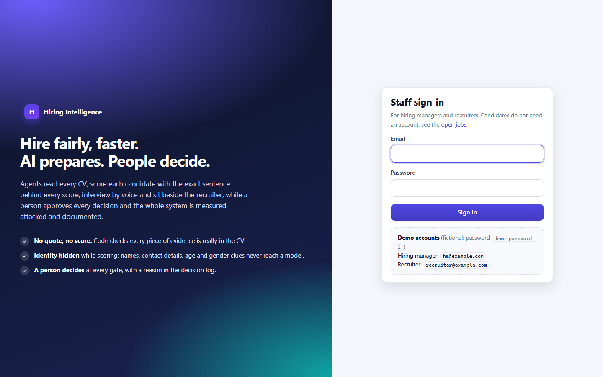
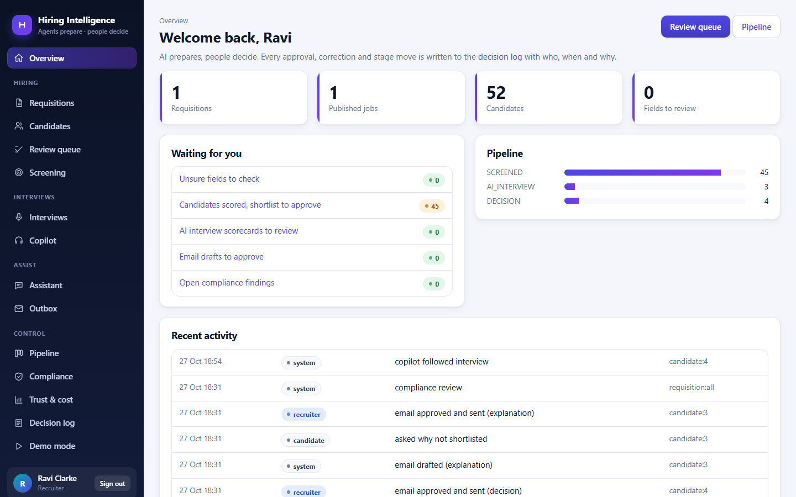
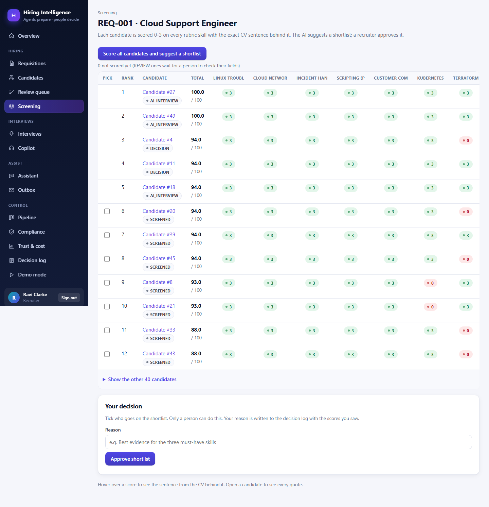
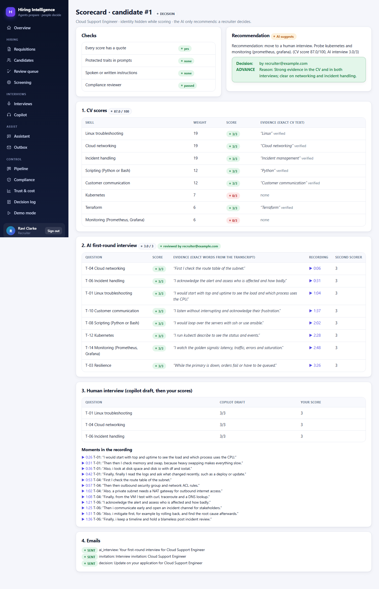
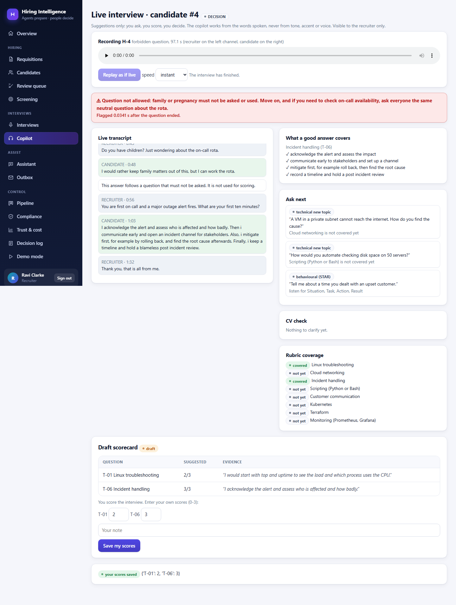
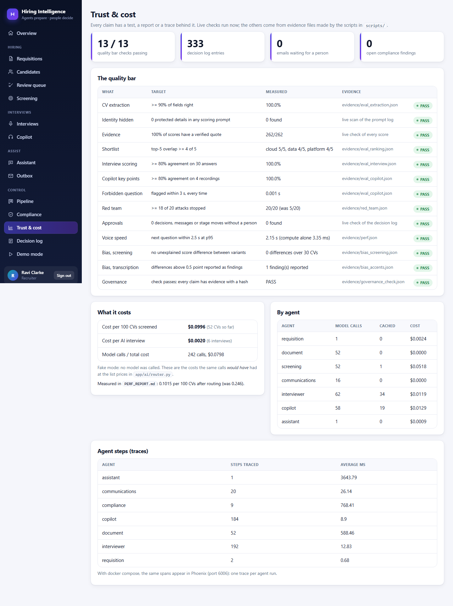
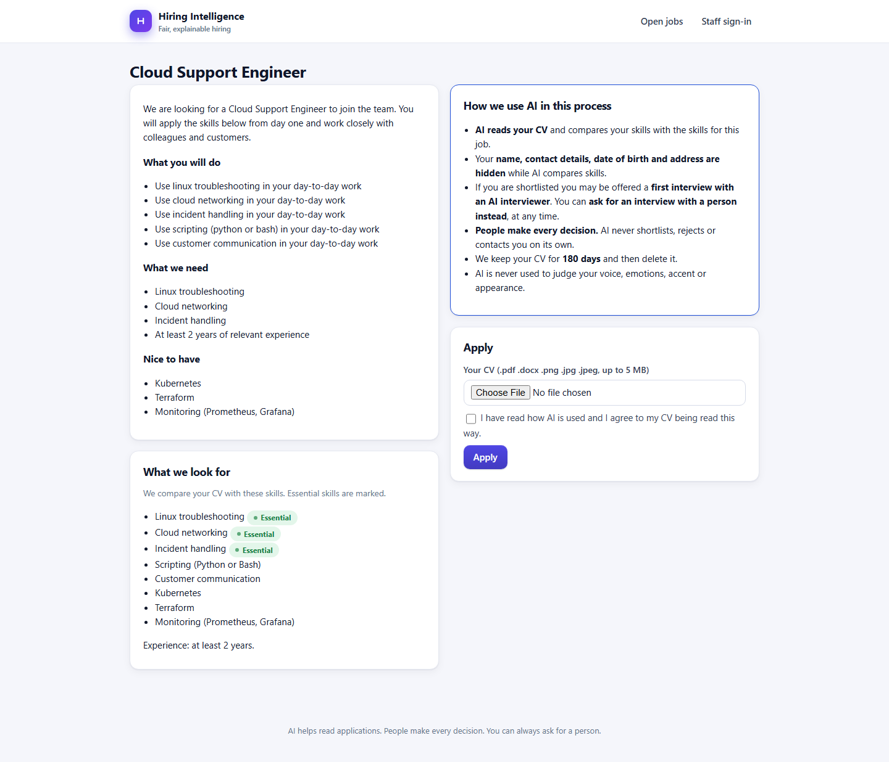
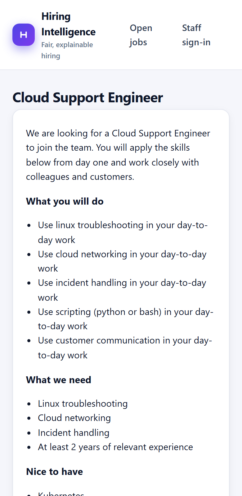

# Hiring Intelligence: AI Hiring Intelligence Platform (Phase 1 capstone)

A hiring platform where **AI agents prepare and people decide**. A hiring manager records a voice note; agents turn it into a fair rubric, read every CV, score each
candidate with the exact sentence behind every score, interview shortlisted candidates by voice, and sit beside the recruiter in the second round. Every decision that
affects a candidate is made and logged by a person. The system is measured, attacked, tested for bias and documented for the EU AI Act.

**Everything in it is fictional** (people, CVs, voices, companies). It runs with **fake models** by default and switches to real models with two settings (see below).

## What it looks like

| | |
|---|---|
|  |  |
| **Sign in** (demo accounts shown in demo mode) | **Overview**: what is waiting for you, the pipeline, recent activity |
|  |  |
| **Screening**: every score has its exact CV quote | **Scorecard**: every quote, links to the moment in the recording, the logged decision |
|  |  |
| **Interview copilot** warning about a forbidden question | **Trust & cost**: the quality bar, with evidence |
|  |  |
| **Candidate's page**: the AI notice and consent | Works on a phone |

More in `docs/screenshots/`. Retake them with `python -m scripts.take_screenshots` (the app must be running and seeded).

## Run it

```
python -m venv .venv && .venv\Scripts\activate           # Windows (use python3 and source .venv/bin/activate elsewhere)
pip install -r requirements.txt
python -m spacy download en_core_web_sm
copy .env.example .env                                   # set SECRET_KEY; FAKE_MODELS=1 needs no key
python -m scripts.check_setup                            # every line should say OK
python -m scripts.run_journey --reset                    # the whole REQ-014 journey in one command
uvicorn app.main:app --port 8001                         # then open http://127.0.0.1:8001
```

Demo accounts (fictional), password `demo-password-1`: **hm@example.com** (hiring manager) and **recruiter@example.com** (recruiter). Candidates have no account:
they apply at `/jobs` and get a private link `/me/<token>`; a shortlisted candidate gets an interview link `/interview/<token>`.

With Docker (API, MCP server and Phoenix traces): `docker compose -f ops/docker-compose.yml up --build`, then http://localhost:8001 (console), http://localhost:6006 (Phoenix).

## What it does, day by day

| Day | You can show | Where |
|---|---|---|
| 1 | A voice note becomes an approved rubric (wording checked); 52 CVs read in four formats; identity hidden; a pipeline that only moves by the rules | `app/agents/requisition.py`, `document.py`, `app/privacy.py`, `app/supervisor.py` |
| 2 | Every candidate scored on every skill with a verified quote; a ranked shortlist a recruiter approves; a full adaptive AI interview by voice: the notice and recording consent, a fixed opening question, questions written from the CV and the answers (a guard checks every one), Mermaid diagrams drawn on the fly, follow-ups and deeper questions chosen by code, hints, a full recording with a timeline, a scorecard with a second scorer and the recruiter's own review before any audio; an assistant that answers with sources | `app/agents/screening.py`, `interviewer.py`, `diagrams.py`, `assistant.py`, `app/shortlist.py`, `app/interview/recording.py`, `scorecard.py`, `app/web/interview.py` |
| 3 | The copilot follows a recorded interview live and flags a forbidden question; emails wait for approval; a compliance reviewer catches a planted fake quote; hidden instructions change nothing; containers, traces, 20-attack red team | `app/agents/copilot.py`, `communications.py`, `compliance.py`, `app/guardrails.py`, `mcp_server/`, `ops/` |
| 4 | One scorecard per candidate with every quote and a link to the moment in the recording; a logged decision; bias tests; cost and speed; the governance pack | `app/decisions.py`, `scripts/run_bias_tests.py`, `run_perf.py`, `build_governance.py` |

The agents (each with its own tools only, a step limit and a trace): **Supervisor** (LangGraph graph with approval gates), **Requisition**, **Document**, **Screening**,
**AI interviewer**, **Interview copilot**, **Recruiter assistant**, **Communications**, **Compliance reviewer**. See `app/agents/base.py` for the table of which agent may call which tool.

## Product features (beyond the course brief)

| Feature | Where |
|---|---|
| **Analytics**: funnel, score spread, interview quality, speed, cost, people-in-the-loop numbers | `/analytics`, `app/analytics.py` |
| **Compare** up to 5 candidates side by side, blind | `/compare` |
| **Filters** on the candidate list (stage, skill, years, CV score) | `/candidates` |
| **Exports**: candidates CSV, decision-log CSV, a scorecard PDF, an audit bundle with a SHA-256 checksum | `/export/...`, `app/web/insights.py` |
| **Company settings and branding** (name, colour, contact) | `/settings` |
| **Users and roles**, including a read-only **auditor**; lockout after 5 wrong passwords, password policy, security headers | `/users`, `/account`, `app/auth.py` |
| **REST API** (read-only, blind, keys shown once, rate limited) and **webhooks** (signed; recorded only unless `WEBHOOKS_LIVE=1`) | `/integrations`, `/api/v1/...`, `app/integrations.py` |
| **Candidate data rights**: download my data; ask for deletion, which a recruiter approves or refuses with a reason | `/me/<token>`, `/data-requests`, `app/datarights.py` |
| **Getting-started checklist** and a **Help** page | `/`, `/help` |

Day 2 in one command: `python -m scripts.day2_demo`. Sample interviews with two voices: `python -m scripts.make_sample_interviews`. Delete old interview audio: `python -m scripts.purge_recordings`.

## The twelve rules (in `CLAUDE.md`) and where each is enforced

1. **A person decides.** `app/supervisor.py` refuses a decision made by the system; `approve_and_send` refuses anything but a person; every decision is logged with who, when, why and the evidence.
2. **Every score has evidence.** `app/evidence.py` checks each quote really is in its source; a score without a verified quote becomes 0; the compliance reviewer re-checks.
3. **Identity is hidden while scoring.** `app/privacy.py` (`make_blind`, with Presidio as a second layer); a test and the compliance reviewer scan every scoring prompt.
4. **Content, never tone.** Scoring functions take transcript text only (a test proves it). No camera.
5. **Candidates are told and can ask for a person.** The apply page, the interview page and the copilot step.
6. **The same core questions for everyone.** `app/interview/bank.py`.
7. **Forbidden questions are flagged.** `app/guardrails.py`; the copilot warns within milliseconds.
8. **Candidate text is data.** Scanned, flagged and removed before a model reads it.
9. **Least privilege.** Per-agent tool lists; the tracking database refuses private columns (SQLite authorizer).
10. **Recordings are personal data.** `scripts/purge_expired.py` deletes CVs after 180 days and recordings after 6 months.
11. **Everything fictional.** Rule 11 of the course; all fixtures are generated.
12. **Prove it.** Every claim has a test, a report or a trace; tests use fake models and recorded audio.

## Prove it: tests, evaluations, reports

```
pytest -q                                   # all tests: fake models, a temporary database, recorded audio, real browser (Playwright)
python -m scripts.quality_gate              # runs every evaluation and the governance check; exit 1 if any target is missed (CI runs this)
python -m scripts.run_red_team              # 20 attacks before and after the guardrails  -> SECURITY_FINDINGS.md
python -m scripts.run_bias_tests --whisper  # counterfactual screening + voice-variant transcription (real Whisper)  -> BIAS_REPORT.md
python -m scripts.run_perf                  # cost per 100 CVs and per interview, voice speed  -> PERF_REPORT.md
```

| Report | What it says |
|---|---|
| `EVAL_REPORT.md` | The quality bar: extraction, ranking, interview scoring, copilot, red team, bias, speed, governance |
| `PERF_REPORT.md` | Cost per 100 CVs and per AI interview, voice speed, before and after routing and caching |
| `SECURITY_FINDINGS.md` | The 20 attacks before and after, defences by layer, accepted risks |
| `BIAS_REPORT.md` | The same CV with a different name, gender or age; the same answers in four voice variants |
| `governance/` | Classification (EU AI Act Annex III point 4), model card, risk register (14 risks), candidate notice, explanation template, evidence with hashes |
| `REQUEST_LOG.md`, `TEAM_LOG.md` | Every request and what happened; how the work was shared |
| `DEMO.md` | The 7-minute demo script |

**Read the numbers honestly.** They were measured with *fake models* (rule-based stand-ins) on fictional data, so they show that the platform, its checks and its guardrails work and that every
claim is measured by a script. They do **not** show how a real model scores: re-run with real models before quoting any figure. The accent test uses four speaking styles from a text-to-speech
engine, not real accents.

## Switching to real models

Everything that calls a model goes through two files, `app/ai/llm.py` and `app/ai/voice.py`, so switching is configuration only:

1. In `.env` set `FAKE_MODELS=0` and `OPENROUTER_API_KEY=...`. The model names (`LARGE_MODEL`, `SMALL_MODEL`, `LOCAL_MODEL`, `FALLBACK_MODEL`, `VISION_MODEL`) are in `.env.example`.
2. For steps that see identity the router uses a local model: install Ollama and `ollama pull llama3.1` (or change `LOCAL_MODEL`).
3. Speech to text is faster-whisper (`WHISPER_MODEL=base.en`; ffmpeg is not needed for WAV). Text to speech uses the system voices (pyttsx3) or the browser's voice.
4. Run `python -m scripts.check_real_models`: it makes one tiny call to each model and says OK or FIX for each.
5. Re-run `python -m scripts.quality_gate` to measure the real models against the same targets.

What changes: the rule-based stand-ins are replaced by prompts that are already written (`SYSTEM` in each agent file), the replies are validated by the same Pydantic models, and the same code checks
(quotes must exist, identity is hidden, instructions are removed) still run after the model. Nothing else in the platform changes.

## Layout

| Path | What it is |
|---|---|
| `app/agents/` | The agents and their tools: `base.py` (tool registry, least privilege, step limits), `requisition*.py`, `document*.py`, `screening.py`, `interviewer.py`, `copilot.py`, `assistant.py`, `communications.py`, `compliance.py` |
| `app/ai/` | The only code that calls models: `llm.py` (JSON output, retry, cache, fallback), `router.py` (small, large, local), `voice.py`, `ledger.py` (prompt log and cost) |
| `app/supervisor.py`, `app/supervisor_graph.py` | The table of allowed moves and the LangGraph supervisor with approval gates and checkpoints |
| `app/privacy.py`, `app/guardrails.py`, `app/evidence.py` | Identity hiding, input/output checks, quote verification |
| `app/search/`, `app/interview/`, `app/voice/` | Hybrid search, the question and diagram banks and plan builder, the interview replayer |
| `app/web/`, `templates/` | The console, the candidate pages, the interview page, the copilot panel |
| `mcp_server/` | The tracking-system MCP server (3 read-only tools; private columns refused by the database) |
| `ops/`, `.github/workflows/ci.yml` | Dockerfile, docker compose (API, MCP, Phoenix), CI |
| `scripts/` | Setup, demo, evaluations, red team, bias tests, cost and speed, governance, retention, kit builders (`scripts/kit/`) |
| `starter_kit/` | Test material, never loaded into the app: voice notes, 52 CVs and their answer key (given) plus the fictional material built for Days 2-4: see `starter_kit/FICTIONAL_ADDITIONS.md` |
| `evidence/`, `governance/` | Evidence files made by the scripts, and the governance pack |

## Known limits

- Fake-model numbers (above). Real-model behaviour is unmeasured until you run it.
- The four recorded human interviews are 70-140 seconds long (the brief says 10-15 minutes): enough to show every copilot feature.
- Windows speech voices only come in two voices; the four "accents" are four speaking styles.
- Scans are read with `rapidocr` (pip) when tesseract is not installed; tesseract is used automatically if it is.
- CI is in `.github/workflows/ci.yml`; GitHub only runs it when the project is the root of its repository.
