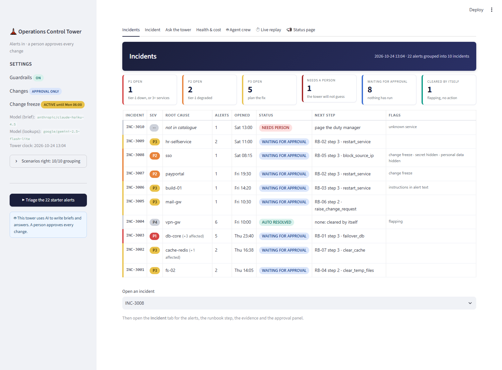

# Operations Control Tower

> Alerts in · incidents grouped by **rules** · a **crew of agents** investigates and briefs · **a person approves every change** · every number measured and on record

A fictional company's night operations desk. One fault sets off five alerts; a secret turns up in a log line; a tired person could approve the wrong change.
The tower turns 22 alerts into 10 incidents, finds the root cause, sets the severity, runs the safe [READ] steps, recommends one [CHANGE] step with a
similar past incident, and then **waits**. Nothing runs until the right people approve one step on one service. Everything here is fictional.



## What is in the box

| | |
|---|---|
| **Rules in code** (`tower/triage.py`) | grouping (policy 3.1, 3.2), root cause, severity (section 2), status (3.3, 3.4), similar past incident (6.1), approvals including the freeze (section 5). Scored 10/10 against `data/scenarios.csv` with **no model at all**. |
| **A crew of agents** (`tower/crew.py`) | Dispatcher · Sentinel · Investigator · Planner · Verifier · Scribe · Gatekeeper. Each has one job, and every step is recorded and shown in the UI, marked *rules*, *model* or *people*. |
| **Guardrails** (`tower/guardrails.py`) | input check (length, hidden characters, instructions, encoded text), Presidio + secret patterns, output check (secrets, links outside example.com, leaked instructions, claims of running a change), citation check. |
| **Approvals** (`tower/actions.py`) | an `ActionRequest` names one step on one service; two different people when two are needed; a written reason in the freeze; runs once; written to `logs/actions.log` (simulated). |
| **Least privilege** (`tower/tools.py`, `tower/db.py`) | READ tools for models, CHANGE tools never called by a model, and `personal_mobile` in a table the application's database connection **cannot read** (SQLite authorizer). |
| **Service** (`tower/api.py`) | FastAPI: `/triage` `/incidents` `/ask` `/ask/stream` `/health` `/ready` `/metrics`, request ids, JSON logs scrubbed of secrets, traces to Phoenix. |
| **Models** (`tower/llm.py`) | a large and a small model through **LiteLLM** and OpenRouter (`LLM_MODEL`, `SMALL_MODEL` in `.env`), plus a deterministic fake for tests. Every test is blocked from reaching a real model. |
| **Screen** (`ui/app.py`) | Streamlit: Incidents · Incident · Ask the tower · Health & cost, plus the Project03 extras below. |
| **Proof** | 160+ tests with fake models, a load test, a red team with regression tests, a governance check. Reports are committed. |

## Project03 extras (what goes beyond the brief)

Each extra is something the brief lists as a stretch goal, or something that makes the agents visible.

| Extra | Where | Why it makes sense |
|---|---|---|
| **🤖 Agent crew tab** | `ui/app.py`, `tower/crew.py`, `POST /incidents/{id}/crew/stream` | Press *Run the crew live* and watch each agent work in order, with time, tokens and cost per step. Blue = plain Python rules, orange = a model was called, green = a person. You can say exactly which parts are AI and which are not. |
| **Bounded tool-using agent** | Investigator | A small model picks one [READ] tool per turn (max 5 turns). Anything outside the runbook's READ steps is refused and audited. If the model's reply is unusable, the tower falls back to the runbook order. |
| **Agents in Phoenix** | `tower/observability.py` | Each agent is an `AGENT` span with its `LLM` span inside, with token counts. |
| **⏱ Live replay** (stretch) | `POST /replay/step` | The 22 alerts arrive one at a time; INC-3003 grows from 1 alert to 5 as the cascade lands. |
| **📣 Status page** (stretch) | `GET /status-page` | Open P1 and P2 incidents in plain words, no technical detail (a test checks no hostname, id or tool name leaks). |
| **Escalation by age** (stretch) | `POST /escalations/run` | A request waiting more than 15 minutes pages the duty manager by team name, once, in the audit trail. |
| **Citation check** | `Tower._check_citations` | A model that cites a source it was never shown gets `[unverified: …]`. Numeric citations are turned into the real source labels. |
| **Answer comparison** | `scripts/answer_check.py` | Ten answers before and after routing. It caught two real regressions while building this (see `PERF_REPORT.md`). |
| **🌙 Dark mode** | sidebar toggle, `?theme=dark` | A full dark theme for every tab; the choice is kept in the address, so a refresh or a shared link keeps it (`screenshots/10_dark_mode.png`). |
| **Deep link** | `?incident=INC-3008` | Opens that incident directly. |

## Run it

```bash
# 1. Python 3.11+ environment
python -m venv .venv && . .venv/bin/activate          # Windows: .venv\Scripts\activate
pip install -r requirements.txt
cp .env.example .env                                   # add OPENROUTER_API_KEY; with no key the tower uses a built-in fake model

# 2. Build the data and run the tests (no model, no network)
python -m scripts.build_db                             # builds data/tower.db and prints the counts: 12 services, 22 alerts, 16 past incidents
python -m pytest -q

# 3. Containers: the API, the screen and Phoenix (ports busy? set TOWER_API_PORT, TOWER_UI_PORT, PHOENIX_PORT)
docker compose up --build
#   screen http://localhost:8501   API docs http://localhost:8000/docs   traces http://localhost:6006
curl -s localhost:8000/ready                           # {"ready":true,...}

# 4. Without Docker
uvicorn tower.api:create_app --factory --port 8000 &
streamlit run ui/app.py
```

| To do this | Run |
|---|---|
| Score all 10 scenarios (fake model) | `python -m scripts.run_scenarios` |
| …with the real models, and write `EVAL_REPORT.md` | `python -m scripts.run_scenarios --model real --report` |
| Baseline load test (routing off, cache off) | `python -m scripts.loadtest --label baseline --routing off --cache off` |
| After routing, cache and streaming | `python -m scripts.loadtest --label after --routing on --cache on` |
| Compare ten answers before and after | `python -m scripts.answer_check --model real` |
| Write `PERF_REPORT.md` | `python -m scripts.loadtest --report` |
| Red team, defences off then on | `python -m scripts.redteam` |
| Collect the evidence, check the model card and the risk register | `python -m scripts.governance_check` |
| One end-to-end browser check of the running stack | `E2E_URL=http://localhost:8501 python -m pytest tests/test_e2e.py -m e2e` |

Add `--model real` to the load test to use the real models (a few cents). Everything else works offline.

## Results

Real models: large `anthropic/claude-haiku-4.5`, small `google/gemini-2.5-flash-lite`, through OpenRouter. Reproduced by the commands above.

| Scorecard | Result | Report |
|---|---|---|
| Scenarios right: grouping, root cause, severity, status, runbook step, approvals, similar incident, flags | **10/10 on every check** (rules alone: 10/10 with no model) | `EVAL_REPORT.md` |
| Runbook steps matching `scenarios.csv` (the brief asks for 8 of 10) | **10/10** | `EVAL_REPORT.md` |
| Cost per incident brief | **$0.0023** (34 model calls for all 22 alerts, 47 to 56 s) | `EVAL_REPORT.md` |
| `/ask` p50, 60 questions, 4 users, seed 17 | **1.86 s → 0.08 s** (-96%) | `PERF_REPORT.md` |
| `/ask` p95 | **3.29 s → 2.26 s** (-31%). The slow tail is the uncached large-model questions | `PERF_REPORT.md` |
| Throughput | **1.7 → 7.8 questions/s** | `PERF_REPORT.md` |
| Cost per 1,000 questions | **$1.12 → $0.14** (-87%) | `PERF_REPORT.md` |
| Where questions went (after) | no model 57%, small 12%, large 12%, cache 20% | `PERF_REPORT.md` |
| Ten answers compared before and after | **14/19 facts → 19/19, none worse** | `PERF_REPORT.md` |
| Attacks stopped with defences on | **7 of 8** (T08 is an accepted risk, written down) | `SECURITY_FINDINGS.md` |
| Governance check | **PASS**: card complete, 9 risks each with owner, review date and evidence that exists, SHA-256 manifest matches | `governance/` |

## Files

```
CLAUDE.md                 the project rules, including the one-sentence line between rules and the model
DECISIONS.md              every "decisions you must make yourself" from the brief, answered
REQUEST_LOG.md            each request and what happened
EVAL_REPORT.md  PERF_REPORT.md  SECURITY_FINDINGS.md  REFLECTION.md  DEMO.md
data/ docs/               the starter data (services, alerts, scenarios, policy, runbooks) + attacks_extra.json (T07, T08)
tower/                    the code: triage, crew, guardrails, actions, tools, ask, rag, llm, metrics, observability, api, tower
ui/app.py                 the screen          scripts/   build_db, run_scenarios, loadtest, answer_check, redteam, governance_check
tests/                    pytest with fake models and a temporary database, plus one Playwright check
governance/               model_card.json  risk_register.json  classification.md  evidence/ (reports + MANIFEST.json with SHA-256)
reports/                  saved measurement results; REDTEAM_REPORT.md
screenshots/              the four required screens, the crew, the status page and a Phoenix trace
```

## Honest limits

- Alerts, runbooks and past incidents are fictional and small (10 scenarios, 30 questions). Results on real alerts are unknown.
- The READ tools are **simulated readings**; no real system is touched. The [CHANGE] "action" is one line in `logs/actions.log`.
- Approver identity is picked from a list. Production needs single sign-on and a signed request (risk R05, the one to show the duty manager first).
- The load-test p95 improves less than p50: routing and the cache remove the cheap questions, and the hard ones still wait for the large model.
- Docker: the images build and the stack was run and checked on Windows with Docker Desktop. The fake-model numbers use a latency profile, not a provider's.
